# StudyBuddy — AI Study Assistant


> **StudyBuddy** is an intelligent, personalized AI study companion that combines conversational tutoring, automated quiz generation, and progress analytics — all powered by Retrieval-Augmented Generation (RAG) and Conversational Augmented Generation (CAG) over your private study materials.

---

## 📖 Problem & Solution Summary

**Problem:** Students struggle to retain information from passive reading, lack personalized practice questions, and have no unified view of their learning progress across topics. Traditional flashcards and static quizzes don't adapt to the learner's level or leverage their own notes.

**Solution:** StudyBuddy transforms any study material (PDFs, DOCX, text files, or even just a topic name) into an interactive learning experience. It provides:
- **Conversational RAG Chat** — Ask questions about your uploaded notes; the agent retrieves relevant context and answers with citations.
- **AI-Generated Quizzes** — Create adaptive multiple-choice quizzes from your notes or any topic (with live web/Wikipedia research), featuring four difficulty levels including a unique "Difficult" mode with mixed single/multiple-answer questions.
- **Progress Analytics** — Track quiz attempts, accuracy trends, topic coverage, and streaks with per-question feedback and partial credit for multi-answer questions.
- **Persistent Memory (CAG)** — The assistant remembers your past conversations and quiz history, enabling follow-up questions and longitudinal learning.

All data is scoped to your user account, stored securely in Pinecone vector database, and accessible across sessions via browser cookies.

---

## 🏗 Architecture Diagram

```mermaid
flowchart TB
    subgraph Frontend["🖥️ Streamlit Frontend (Port 8501)"]
        Auth["Authentication Page\n(Sign In / Sign Up)"]
        Main["Main Page\n3 Tabs: Chat | Notes & Quiz | Progress"]
        ChatTab["💬 Chat Tab\n• Streaming responses\n• Session history sidebar\n• CAG context injection"]
        QuizTab["📝 Notes & Quiz Tab\n• File upload (PDF/DOCX/TXT)\n• Topic-based quiz generation\n• Interactive quiz UI\n• Real-time progress bars"]
        ProgressTab["📊 Progress Tab\n• Summary metrics\n• Attempt history\n• Topic coverage\n• Accuracy trends"]
    end

    subgraph Backend["⚙️ Python Modules (Shared Process)"]
        AuthMod["auth.py\n• JWT tokens\n• Bcrypt hashing\n• Browser cookie bridge\n• FastAPI verification (port 8000)"]
        ChatMod["Chatbot.py\n• Two-step pipeline:\n  1. LangGraph Agent + Tools\n  2. JSON Formatter LLM\n• CAG: chat history retrieval\n• Tools: notes, quizzes, wiki, web"]
        QuizMod["Notes_Quiz_Section.py\n• Dynamic chunking + noise filter\n• lightningdoc / pymupdf4llm extraction\n• LangChain research agent\n• Quiz evaluation + partial credit"]
        ProgMod["Progress.py\n• Unique quiz IDs\n• Deduplication (hash + cache)\n• Namespace-isolated storage\n• Timezone-aware timestamps"]
    end

    subgraph Data["🗄️ Pinecone Vector Database (studybuddy index)"]
        NSUsers["namespace: users\n• user_auth vectors\n• email + bcrypt hash"]
        NSNotes["namespace: notes\n• note chunks (768-d)\n• quiz vectors\n• metadata: user_id, type, timestamp"]
        NSChat["namespace: chat_history\n• conversation vectors\n• CAG semantic search"]
        NSProg["namespace: progress\n• quiz result vectors\n• quiz_number, quiz_id\n• progress_hash for dedup"]
    end

    subgraph External["🌐 External Services"]
        Gemini["Google Gemini\n• embedding-2 (768-d)\n• Task-aware prefixes"]
        Groq["Groq / GPT-OSS\n• openai/gpt-oss-20b (agent)\n• openai/gpt-oss-120b (quiz)"]
        Tavily["Tavily API\n• Advanced web search"]
        Wiki["Wikipedia API\n• Encyclopedia lookup"]
        FastAPI["FastAPI Auth Service\n• /auth/login\n• /auth/register\n• /auth/verify"]
    end

    %% Connections
    Auth -->|HTTP| FastAPI
    Main -->|imports| AuthMod
    Main -->|imports| ChatMod
    Main -->|imports| QuizMod
    Main -->|imports| ProgMod
    
    ChatMod -->|embed + query| NSChat
    ChatMod -->|embed + query| NSNotes
    ChatMod -->|store| NSChat
    ChatMod -.->|tools| Groq
    ChatMod -.->|tools| Tavily
    ChatMod -.->|tools| Wiki
    ChatMod -->|embed| Gemini
    
    QuizMod -->|embed + upsert| NSNotes
    QuizMod -->|research| Groq
    QuizMod -->|research| Tavily
    QuizMod -->|research| Wiki
    QuizMod -->|store quiz| NSNotes
    QuizMod -->|eval + store| NSProg
    QuizMod -->|extract| Gemini
    
    ProgMod -->|embed + upsert| NSProg
    ProgMod -->|query| NSProg
    ProgMod -->|cleanup| NSProg
    
    AuthMod -->|verify| FastAPI
    AuthMod -->|store user| NSUsers
    AuthMod -->|find user| NSUsers
    
    style Frontend fill:#1a1f3a,stroke:#4fded8,stroke-width:2px
    style Backend fill:#1a1f3a,stroke:#8a7bff,stroke-width:2px
    style Data fill:#1a1f3a,stroke:#ff6b9d,stroke-width:2px
    style External fill:#1a1f3a,stroke:#ffd166,stroke-width:2px
```



---

## 🔄 Agent / RAG Workflow

### 1. Conversational RAG + CAG Pipeline (`Chatbot.py`)

```
User Question
      │
      ▼
┌─────────────────────────────────────┐
│ CAG: Retrieve Relevant Chat History │
│ (semantic search on chat_history)   │
└─────────────────────────────────────┘
      │
      ▼
┌─────────────────────────────────────┐
│ STEP 1: LangGraph Agent (Groq)      │
│ • Tools: search_notes, search_quizzes,          │
│   search_chat_history, search_wikipedia,        │
│   web_search                                   │
│ • System prompt + CAG context                  │
│ • Output: Prose answer + tool call log         │
└─────────────────────────────────────┘
      │
      ▼
┌─────────────────────────────────────┐
│ STEP 2: Formatter LLM (Groq + JSON) │
│ • Input: Prose answer + tool names  │
│ • Output: Structured StudyBuddyResponse │
│   {summary, key_points[], details?, │
│    sources[], follow_up?}           │
└─────────────────────────────────────┘
      │
      ▼
┌─────────────────────────────────────┐
│ Render → Stream to UI               │
│ Store conversation in Pinecone      │
└─────────────────────────────────────┘
```

**Key Design Decisions:**
- **Two-step pipeline** because Groq rejects `response_format=json_object` when tools are bound. Step 1 uses tools freely; Step 2 formats to strict JSON.
- **Task-aware embeddings**: Queries use `task: search result | query: ` prefix; documents use `title: none | text: ` prefix (Gemini Embedding 2 best practice).
- **Locked `top_k=3`** for retrieval consistency with evaluation harness.
- **Duplicate prevention** via MD5 content hash + in-memory TTL cache (60s for responses, 5min for conversations).

---

### 2. Quiz Generation & Evaluation Workflow (`Notes_Quiz_Section.py`)

```
User Input (Notes Text OR Topic Name)
      │
      ▼
┌─────────────────────────────────────┐
│ If Topic + Tools Enabled:           │
│ LangChain Research Agent            │
│ (GPT-OSS-120b + Wikipedia + Tavily) │
│ → Comprehensive research summary    │
└─────────────────────────────────────┘
      │
      ▼
┌─────────────────────────────────────┐
│ Quiz Generation Prompt (Groq)       │
│ • Difficulty config (Easy/Medium/   │
│   Hard/Difficult)                   │
│ • Dynamic single/multiple answer    │
│   ratio (Difficult = 60%+ multi)    │
│ • Strict JSON schema output         │
└─────────────────────────────────────┘
      │
      ▼
┌─────────────────────────────────────┐
│ Store in Pinecone (notes namespace) │
│ • Quiz vector + metadata            │
│ • Note chunks (dynamic chunking)    │
└─────────────────────────────────────┘
      │
      ▼
┌─────────────────────────────────────┐
│ Interactive Quiz UI (Streamlit)     │
│ • Per-question option cards         │
│ • Multi-segment progress bar        │
│ • Circle progress indicator         │
│ • Immediate feedback on submit      │
└─────────────────────────────────────┘
      │
      ▼
┌─────────────────────────────────────┐
│ Evaluation (evaluate_quiz_attempt)  │
│ • Exact match for single-answer     │
│ • Partial credit for multi-answer:  │
│   (correct_selected - 0.5×extra) /  │
│   total_correct                     │
│ • Store in progress namespace       │
└─────────────────────────────────────┘
```

**Dynamic Chunking Strategy:**
| Corpus Size | Max Chars | Overlap | Min Chars |
|-------------|-----------|---------|-----------|
| Small (<50 chunks) | 1400 | 2 sentences | 200 |
| Medium (50–200) | 1200 | 1 sentence | 200 |
| Large (>200) | 900 | 1 sentence | 200 |

**Noise Filter** removes: page numbers, TOC entries, bibliography lines, URL-heavy fragments, DOI/ISBN citations, "Retrieved YYYY" boilerplate.

---

## ✨ Features & Technology Stack

### Core Features

| Feature | Description |
|---------|-------------|
| **🔐 Secure Authentication** | Email/password with bcrypt, JWT tokens (7-day expiry), browser cookie persistence via JS bridge |
| **💬 Conversational Chat** | Streaming responses, structured output (summary + key points + sources), CAG memory across sessions |
| **📝 Notes Upload** | PDF (lightningdoc → pymupdf4llm → PyMuPDF fallback), DOCX, TXT with math glyph normalization |
| **🧠 Quiz Generation** | From notes OR topic (with live web/Wikipedia research), 4 difficulties, configurable question count |
| **🎯 Difficult Mode** | Mixed single/multiple-answer questions; answer type hidden until submission |
| **📊 Progress Dashboard** | Summary cards (attempts, avg score, accuracy, topics), attempt history with quiz numbers, 7-day activity |
| **🔁 Deduplication** | Content-hash based prevention at cache + Pinecone level for notes, quizzes, conversations, progress |
| **🌍 Timezone Support** | User-local timestamps with relative time ("2 hours ago") via `pytz` |

### Technology Stack

| Layer | Technologies |
|-------|--------------|
| **Frontend** | Streamlit 1.38+, custom CSS (CSS variables, gradients, animations), base64 asset embedding |
| **LLM / Agent** | Groq (GPT-OSS-20b for chat agent, GPT-OSS-120b for quiz/research), LangGraph, LangChain |
| **Embeddings** | Google Gemini `embedding-2` (768-d, task-aware prefixes) |
| **Vector DB** | Pinecone Serverless (AWS us-east-1), 4 namespaces (`users`, `notes`, `chat_history`, `progress`) |
| **Auth** | FastAPI (separate service, port 8000), JWT (HS256), bcrypt, browser cookies via `st.markdown(JS)` |
| **Research Tools** | Tavily (advanced web search), Wikipedia (REST + library fallback) |
| **Document Processing** | `lightningdoc` (primary), `pymupdf4llm`, `PyMuPDF`, `docx2txt` |
| **Utilities** | `python-dotenv`, `pytz`, `numpy`, `opencv-python-headless`, `Pillow`, `pytesseract` |

### Project Structure

```
StudyBuddy/
├── app.py                      # Entry point → routes to Auth or Main
├── pages/
│   ├── Authentication_Page.py  # Login / Signup tabs
│   └── Main_Page.py            # 3-tab dashboard (Chat, Notes & Quiz, Progress)
├── auth.py                     # Cookie-based auth + FastAPI client
├── Chatbot.py                  # RAG + CAG chat pipeline (two-step)
├── Notes_Quiz_Section.py       # Quiz gen, evaluation, file extraction, chunking
├── Progress.py                 # Progress storage, fetch, dedup, cleanup
├── style.css                   # Complete theming (dark, gradients, animations)
├── requirements.txt            # Python dependencies
├── Dockerfile                  # Container definition
├── Assets/                     # Icons, GIFs, illustrations
└── .env.example                # Environment template (see below)
```

---

## 📸 Screenshots

### Authentication

*Clean sign-in / sign-up with gradient theming and toast notifications*

### Chat Tab — Conversational RAG with CAG

*Streaming structured responses with source citations; sidebar shows session history*

### Notes & Quiz Tab — Upload & Generate

*Drag-and-drop file upload, difficulty selector, topic input with research agent toggle*

### Interactive Quiz UI

*Per-question option cards, multi-segment progress bar, circle indicator, real-time accuracy*

### Quiz Results & Feedback

*Score breakdown, partial credit, per-question review with explanations, action buttons*

### Progress Dashboard

*Summary metrics, recent attempts with quiz numbers, topic coverage, 7-day activity*

---

## 🎬 Video Demo

*To be added — will showcase: signup → upload notes → generate quiz (Difficult mode) → take quiz → review results → check progress → ask follow-up in chat with CAG memory*

---

## 🛠 Local Setup

### Prerequisites
- Python 3.11+
- Pinecone account (free tier) → create index `studybuddy` (768-d, cosine, serverless AWS us-east-1)
- Google AI Studio API key (Gemini)
- Groq API key
- Tavily API key (optional, for web search)
- FastAPI auth service running on `http://127.0.0.1:8000` (see note below)

### 1. Clone & Install

```bash
git clone <your-repo-url>
cd "Study-Buddy AI Study Assistant/Frontend+Backend(Streamlit+Gemini+Pinecon"
python -m venv .venv
source .venv/bin/activate  # Windows: .venv\Scripts\activate
pip install -r requirements.txt
```

### 2. Configure Environment

```bash
cp .env.example .env
# Edit .env with your keys (see .env.example below)
```

### 3. Run FastAPI Auth Service (separate terminal)

```bash
# The auth module expects a FastAPI service at API_URL with:
# POST /auth/login    {email, password} → {token, user: {user_id, email}}
# POST /auth/register {email, password} → {user: {user_id, email}}
# GET  /auth/verify   ?token=... → {valid: true, user_id, email}
# Implement this separately or use the provided auth microservice.
```

### 4. Launch Streamlit

```bash
streamlit run app.py
# Opens at http://localhost:8501
```

---

### `.env.example`

```ini
# ============================================
# REQUIRED — Core Services
# ============================================
GEMINI_API_KEY=your_google_ai_studio_key
PINECONE_API_KEY=your_pinecone_api_key
INDEX_NAME=studybuddy
PINECONE_ENVIRONMENT=us-east-1
PINECONE_REGION=us-east-1
GROQ_API_KEY=your_groq_api_key

# ============================================
# REQUIRED — Authentication
# ============================================
API_URL=http://127.0.0.1:8000          # FastAPI auth service
JWT_SECRET=generate_a_strong_random_string_here

# ============================================
# OPTIONAL — Research Tools
# ============================================
TAVILY_API_KEY=your_tavily_key         # Web search (advanced)
# Wikipedia requires no key

# ============================================
# OPTIONAL — Tuning
# ============================================
DEFAULT_TIMEZONE=UTC
RAG_TOP_K=3                            # Locked for eval consistency
MAX_CHUNK_CHARS=1200
MIN_CHUNK_CHARS=200
CHUNK_OVERLAP_SENTENCES=1
SMALL_CORPUS_THRESHOLD=50
MEDIUM_CORPUS_THRESHOLD=200
```

> **Generate `JWT_SECRET`**: `openssl rand -hex 32`

---

## 🐳 Docker Deployment

### Dockerfile (included)

```dockerfile
FROM python:3.11-slim
WORKDIR /app
COPY requirements.txt .
RUN pip install --no-cache-dir -r requirements.txt
COPY . .
EXPOSE 8501
CMD ["streamlit", "run", "app.py", "--server.port=8501", "--server.address=0.0.0.0"]
```

### Build & Run

```bash
# Build
docker build -t studybuddy:latest .

# Run (with env file)
docker run -d \
  --name studybuddy \
  -p 8501:8501 \
  --env-file .env \
  studybuddy:latest

# View logs
docker logs -f studybuddy
```

### Docker Compose (recommended for full stack)

```yaml
# docker-compose.yml
version: '3.8'

services:
  studybuddy:
    build: .
    ports:
      - "8501:8501"
    env_file: .env
    depends_on:
      - auth-api
    restart: unless-stopped

  auth-api:
    # Replace with your FastAPI auth service image/build
    image: your-auth-service:latest
    ports:
      - "8000:8000"
    environment:
      - DATABASE_URL=postgresql://user:pass@db:5432/auth
    depends_on:
      - db
    restart: unless-stopped

  db:
    image: postgres:16-alpine
    environment:
      - POSTGRES_USER=user
      - POSTGRES_PASSWORD=pass
      - POSTGRES_DB=auth
    volumes:
      - pgdata:/var/lib/postgresql/data
    restart: unless-stopped

volumes:
  pgdata:
```

```bash
docker compose up -d --build
```

---

## 🔁 CI/CD Explanation

### Recommended Pipeline (GitHub Actions)

```yaml
# .github/workflows/ci.yml
name: CI/CD

on:
  push:
    branches: [main]
  pull_request:
    branches: [main]

env:
  PYTHON_VERSION: '3.11'

jobs:
  lint-and-test:
    runs-on: ubuntu-latest
    steps:
      - uses: actions/checkout@v4
      
      - name: Set up Python
        uses: actions/setup-python@v5
        with:
          python-version: ${{ env.PYTHON_VERSION }}
      
      - name: Cache pip
        uses: actions/cache@v4
        with:
          path: ~/.cache/pip
          key: ${{ runner.os }}-pip-${{ hashFiles('requirements.txt') }}
      
      - name: Install dependencies
        run: |
          python -m pip install --upgrade pip
          pip install -r requirements.txt
          pip install ruff pytest pytest-cov
      
      - name: Lint (ruff)
        run: ruff check . --output-format=github
      
      - name: Format check
        run: ruff format --check .
      
      - name: Unit tests
        run: pytest tests/ -v --cov=./ --cov-report=xml
      
      - name: Upload coverage
        uses: codecov/codecov-action@v4

  docker-build:
    needs: lint-and-test
    runs-on: ubuntu-latest
    if: github.event_name == 'push' && github.ref == 'refs/heads/main'
    steps:
      - uses: actions/checkout@v4
      
      - name: Set up Docker Buildx
        uses: docker/setup-buildx-action@v3
      
      - name: Log in to GHCR
        uses: docker/login-action@v3
        with:
          registry: ghcr.io
          username: ${{ github.actor }}
          password: ${{ secrets.GITHUB_TOKEN }}
      
      - name: Build and push
        uses: docker/build-push-action@v5
        with:
          context: .
          push: true
          tags: ghcr.io/${{ github.repository }}/studybuddy:${{ github.sha }}
          cache-from: type=gha
          cache-to: type=gha,mode=max

  deploy-staging:
    needs: docker-build
    runs-on: ubuntu-latest
    environment: staging
    steps:
      - name: Deploy to staging
        run: |
          # Example: SSH to staging server, docker compose pull && up -d
          echo "Deploy to staging server..."
```

### Pipeline Stages

| Stage | Purpose | Tools |
|-------|---------|-------|
| **Lint** | Code style, import sorting, unused imports | `ruff` (fast, replaces flake8+isort+black) |
| **Format** | Enforce consistent formatting | `ruff format` (Black-compatible) |
| **Unit Tests** | Test core logic (chunking, evaluation, auth helpers) | `pytest` with fixtures |
| **Coverage** | Track test coverage | `pytest-cov` + Codecov |
| **Docker Build** | Multi-arch image, layer caching | `docker/build-push-action` |
| **Deploy** | Rolling update to staging/prod | SSH, Kubernetes, or managed platform (Fly.io, Render, Cloud Run) |

### Secrets Management
- Store `GEMINI_API_KEY`, `PINECONE_API_KEY`, `GROQ_API_KEY`, `TAVILY_API_KEY`, `JWT_SECRET` in GitHub **Environments** or **Repository Secrets**
- Never commit `.env` to version control

---

## 🧪 Testing Instructions

### Unit Tests (suggested structure)

```bash
# Create tests/ directory
mkdir -p tests
```

**Example test files:**

```python
# tests/test_chunking.py
import pytest
from Notes_Quiz_Section import chunk_text, _is_noise

def test_noise_filter_page_number():
    assert _is_noise("42") is True
    assert _is_noise("Page 42") is False

def test_noise_filter_bibliography():
    assert _is_noise("1. Smith, J. Title. Publisher.") is True

def test_chunk_text_basic():
    text = "Sentence one. " * 50  # ~600 chars
    chunks = chunk_text(text, max_chars=200, overlap_sentences=1, min_chars=50, auto_dynamic=False)
    assert len(chunks) >= 2
    assert all(len(c) >= 50 for c in chunks)

def test_chunk_text_overlap():
    text = "A. B. C. D. E."
    chunks = chunk_text(text, max_chars=10, overlap_sentences=1, min_chars=1, auto_dynamic=False)
    # With overlap, sentences should appear in adjacent chunks
    assert any("B" in c and "C" in c for c in chunks)

# tests/test_quiz_evaluation.py
from Notes_Quiz_Section import evaluate_quiz_attempt

def test_single_answer_correct():
    quiz = {"quiz": [{"question": "Q?", "options": {"A": "1", "B": "2"}, "answer": "A", "answer_type": "single"}]}
    result = evaluate_quiz_attempt(quiz, {0: "A"}, user_id=None, store_progress=False)
    assert result["score"] == 1
    assert result["accuracy"] == 100

def test_multi_answer_partial_credit():
    quiz = {"quiz": [{"question": "Q?", "options": {"A": "1", "B": "2", "C": "3", "D": "4"}, "answer": "A,B", "answer_type": "multiple"}]}
    result = evaluate_quiz_attempt(quiz, {0: "A"}, user_id=None, store_progress=False)  # Missing B
    assert result["partial_credit"] > 0
    assert result["adjusted_score"] > result["score"]

# tests/test_auth_helpers.py
from auth import validate_user_id

def test_validate_user_id():
    assert validate_user_id("user_123") is True
    assert validate_user_id("default_user") is False
    assert validate_user_id("") is False
    assert validate_user_id(None) is False
```

### Run Tests

```bash
# Install test deps
pip install pytest pytest-cov ruff

# Run with coverage
pytest tests/ -v --cov=. --cov-report=term-missing

# Lint
ruff check .

# Format check
ruff format --check .
```

### Integration Test (manual)

1. Start FastAPI auth service
2. Run `streamlit run app.py`
3. Sign up → verify email/password persistence across browser restart
4. Upload PDF → verify chunks appear in Pinecone `notes` namespace
5. Generate quiz (topic + tools) → verify research agent calls Tavily/Wikipedia
6. Take quiz in Difficult mode → verify mixed answer types, partial credit
7. Check Progress tab → verify quiz_number increments, summary stats update
8. Chat tab → ask about quiz topic → verify CAG retrieves prior context

---

## 🔒 Security Considerations

| Area | Implementation | Notes |
|------|----------------|-------|
| **Password Storage** | bcrypt (cost factor default 12) | Never stored in plaintext |
| **Session Tokens** | JWT HS256, 7-day expiry, `user_id` + `email` claims | Secret in `.env`, rotate periodically |
| **Cookie Security** | `HttpOnly`-equivalent via JS bridge, `path=/`, 7-day expiry | Consider `Secure` + `SameSite=Lax` in production via reverse proxy |
| **API Verification** | All auth calls go to FastAPI `/auth/verify` with token | Pinecone never receives raw passwords |
| **User Isolation** | Every Pinecone query includes `filter: {user_id: {$eq: ...}}` | Namespace separation + metadata filtering |
| **Input Validation** | `validate_user_id()` rejects placeholders (`default_user`, `Unknown`, etc.) | Prevents cross-user data leakage |
| **Rate Limiting** | Not built-in; add at reverse proxy (nginx, Cloudflare) or FastAPI middleware | Recommended for production |
| **Secrets Management** | `.env` + Docker secrets / GitHub Actions secrets | Never commit `.env` |
| **CORS** | Configure FastAPI `CORSMiddleware` for your frontend origin | Restrict to known domains |

### Known Limitations

| Limitation | Impact | Mitigation |
|------------|--------|------------|
| **Single-process Streamlit** | All users share Python process; memory caches (`_conversation_cache`, `_response_cache`, `_storage_cache`, `_progress_cache`) are global | Use Redis-backed cache for horizontal scaling |
| **No built-in rate limiting** | API keys (Gemini, Groq, Tavily) can be exhausted | Implement token bucket at FastAPI layer or API gateway |
| **Pinecone serverless cold starts** | First query after idle may add 1–2s latency | Warm-up endpoint or provisioned index for high traffic |
| **Groq model availability** | `gpt-oss-20b` / `gpt-oss-120b` subject to deprecation | Pin model versions, have fallback (e.g., `llama-3.1-70b-versatile`) |
| **File upload size** | Streamlit default 200MB; large PDFs may OOM | Chunk large files client-side or add `st.file_uploader(max_size_mb=50)` |
| **Timezone handling** | Relies on `pytz`; user timezone not persisted per-session | Store `user_timezone` in user profile, pass explicitly |
| **No admin dashboard** | Cannot view/manage users, quotas, or system health | Build internal admin page or use Pinecone console |
| **Single auth service** | FastAPI auth is a SPOF | Deploy with replicas + health checks |

---

## 📄 License

MIT License — see [LICENSE](LICENSE) for details.

---

## 🙏 Acknowledgments

- **Google Gemini** for state-of-the-art embeddings with task prefixes
- **Groq** for blazing-fast GPT-OSS inference
- **Pinecone** for serverless vector search with metadata filtering
- **LangGraph / LangChain** for agent orchestration
- **Tavily** for reliable web search API
- **Streamlit** for the delightful Python-to-UI framework
- **lightningdoc / pymupdf4llm** for best-in-class PDF extraction

---

*Built with ❤️ for learners everywhere. Happy studying!*